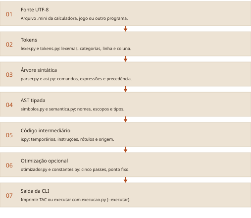
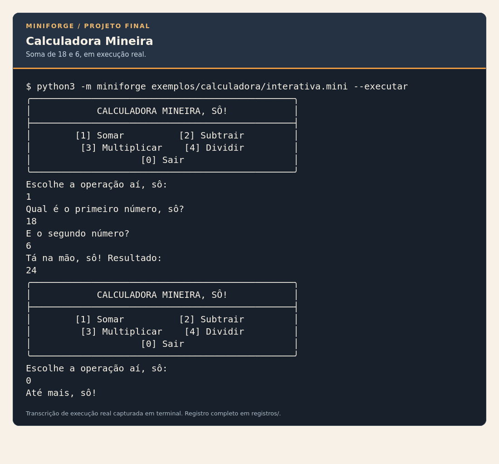
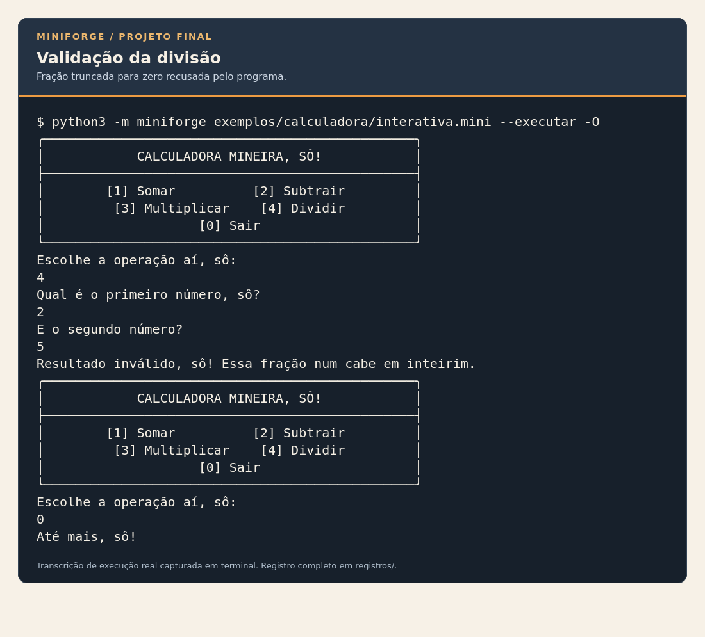
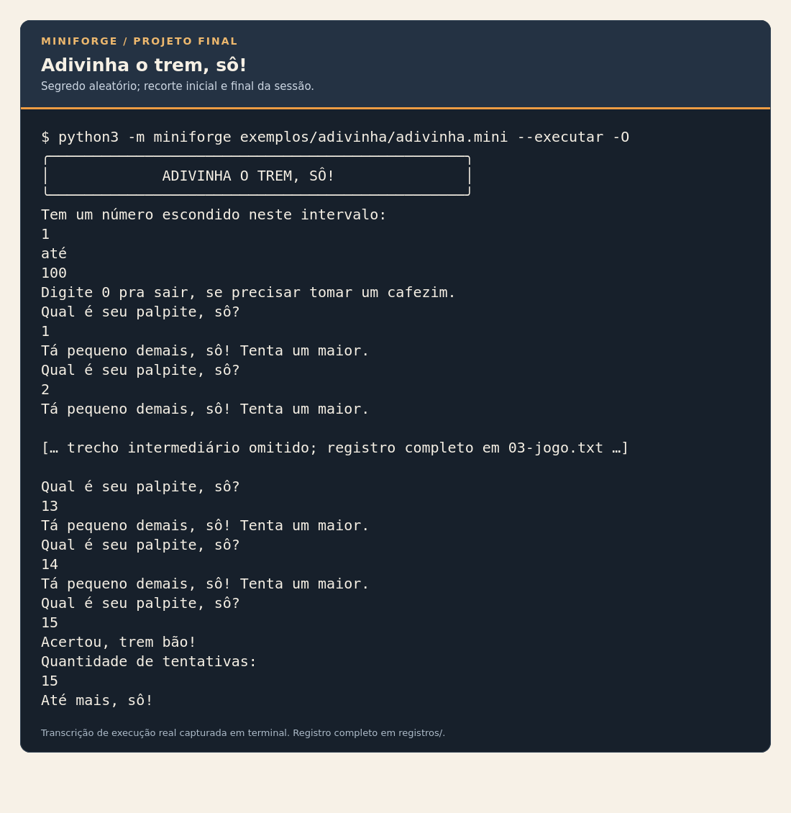
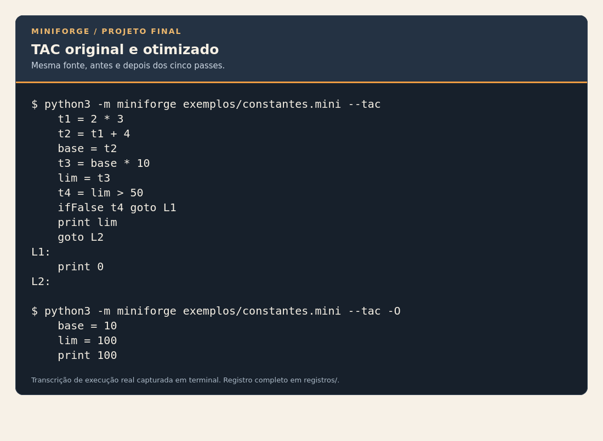
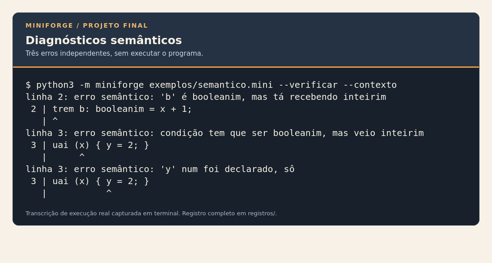
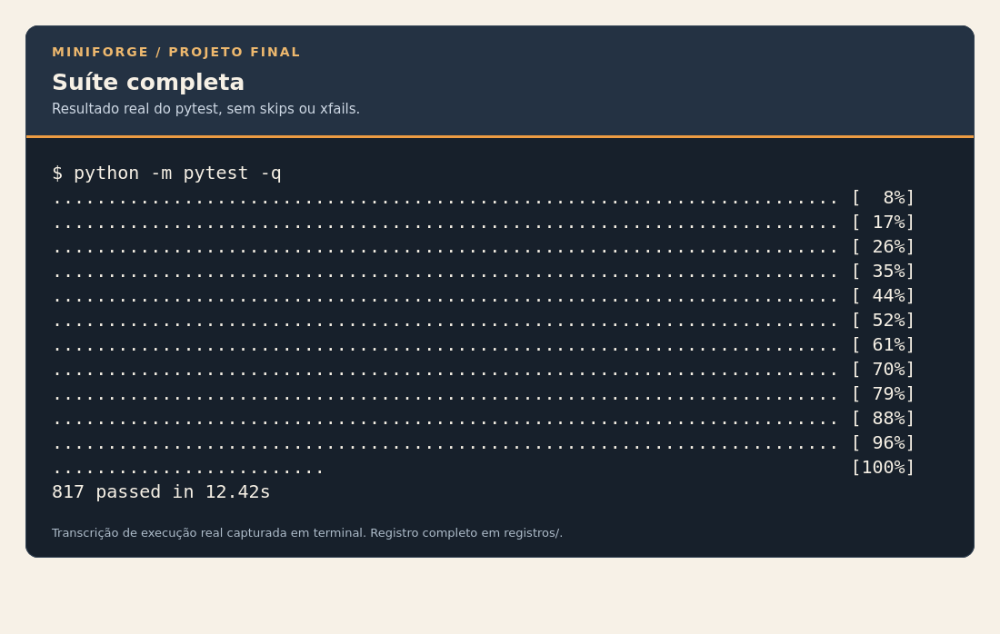

# MiniForge - Projeto Final

Captura de 13/11/2026. Base: 71c0eaea7e485f4c0f691b9f851bead7beda30a4.

# Relatório final do MiniForge

**Disciplina:** Compiladores, 2026.2

**Professora:** Lorena Bezerra

**Integrantes:** Pedro Dutra, Pedro Pignata, Lucas Rocha Dantas e Renato Portilho

**Captura desta entrega:** 13/11/2026

## 1. Resumo e resultado atual

O MiniForge é um compilador didático implementado em Python para uma linguagem
própria, o mineirês. O processamento reconhece tokens, constrói AST, resolve
nomes e escopos, verifica tipos, gera código de três endereços (TAC) e aplica
cinco passes de otimização até ponto fixo. O projeto inclui execução
explícita de TAC, entrada inteira, saída de mensagens e sorteio inteiro inclusivo.

Dois programas completos exercitam esses recursos: Calculadora Mineira e
Adivinha o trem, sô!. Menu, entrada, escolhas, contas, dicas e repetição estão
nos fontes .mini. O executor Python é genérico e não decide o comportamento
de cada aplicação por um aplicativo auxiliar.

A suíte tem 817 testes aprovados. A documentação reúne as decisões técnicas,
as métricas estáticas e as instruções para compilar, executar e conferir os
programas do projeto.

## 2. Objetivos e decisões

O objetivo acadêmico é implementar as responsabilidades das fases de um
compilador e acompanhar a transformação de representações. A linguagem pequena
permite observar uma expressão desde os caracteres até a instrução intermediária.
O vocabulário mineiro dá identidade ao projeto, mantendo regras sintáticas e de
tipos explícitas. Python é a linguagem de implementação; mineirês é a linguagem
que o compilador analisa. O fonte não é encaminhado a eval.

A organização segue o modelo do roteiro: pacote, testes, exemplos e documentos
separados. Os nomes genéricos minilang dos slides correspondem a miniforge.
O executor fica em execucao.py e exerce o papel de backend simples de TAC.
O projeto usa essa representação diretamente, sem bytecode de pilha.

## 3. Concepção e desenvolvimento do projeto

O MiniForge é o projeto do grupo para aplicar os conceitos de construção de
compiladores. A linguagem mineirês reúne um vocabulário próprio e regras
explícitas de sintaxe, tipos e escopos. A implementação separa as fases para
permitir examinar cada transformação e localizar os diagnósticos.

O trabalho compreende a especificação da linguagem, a construção do frontend,
a geração de TAC, os cinco passes de otimização e o executor. Os testes
acompanham os contratos de cada fase e verificam também os programas completos.
A documentação apresenta as decisões técnicas e os comandos para reproduzir
os resultados.

A Calculadora Mineira e o jogo Adivinha o trem, sô! demonstram o uso da linguagem
criada pelo grupo. Ambos utilizam a mesma cadeia de compilação e execução,
com entrada pelo teclado, mensagens e controle de fluxo definidos nos fontes
em mineirês, salvos com a extensão .mini.

## 4. Linguagem e contratos

| Palavra | Representação | Exemplo |
|---|---|---|
| trem | Declaração inicializada | `trem x: inteirim = 18;` |
| inteirim | Inteiro | `trem y: inteirim = 6;` |
| booleanim | Booleano | `trem ok: booleanim = eh_memo;` |
| eh_memo | Verdadeiro | `ok = eh_memo;` |
| num_eh | Falso | `ok = num_eh;` |
| uai | Condicional | `uai (ok) { mostra_so(1); }` |
| sinao | Alternativa | `uai (ok) { mostra_so(1); } sinao { mostra_so(0); }` |
| enquanto_tiver | Repetição | `enquanto_tiver (x > 0) { x = x - 1; }` |
| mostra_so | Saída | `mostra_so("Bão demais!");` |
| le_so | Leitura inteira | `le_so(x);` |
| sorteia_so | Sorteio inclusivo em execução | `x = sorteia_so(1, 100);` |

Tipos internos int e bool não possuem coerção implícita. A aritmética recebe
inteiros; comparações ordenadas produzem booleanos; igualdade exige operandos
do mesmo tipo. Condições exigem booleanos. Divisão inteira trunca para zero,
inclusive com negativos, sem conversão intermediária para float.

Declarações são inicializadas, blocos exigem chaves e comparações não podem
ser encadeadas. Cada bloco abre escopo. Redeclaração no mesmo escopo é erro;
sombreamento interno é permitido. O inicializador é analisado antes da inserção
do novo símbolo. Comentários começam com //; os fontes são UTF-8.

Mensagens entre aspas duplas só são permitidas como saída literal. Não são
valores de um novo tipo de variável e não possuem escapes ou interpolação.
le_so exige variável inteira já declarada e solicita novamente quando a entrada
não representa inteiro. EOF durante leitura é erro de execução.

sorteia_so recebe duas expressões inteiras, avaliadas da esquerda para a direita.
Os extremos são inclusivos; limites invertidos causam erro em execução.
Cada chamada alcançada sorteia novamente usando SystemRandom, sem semente fixa.
Repetição de valores entre chamadas é possível. A compilação não faz sorteio.

Contratos completos: [especificacao.md](https://github.com/PedroPignata/Compiladores/blob/main/MiniForge/docs/especificacao.md), [gramatica.md](https://github.com/PedroPignata/Compiladores/blob/main/MiniForge/docs/gramatica.md)
e [sorteio.md](https://github.com/PedroPignata/Compiladores/blob/main/MiniForge/docs/sorteio.md).

## 5. Arquitetura e fases

```text
MiniForge/
  miniforge/  implementação por fase e CLI
  tests/      regressões, cenários das aplicações e casos de referência
  exemplos/   fontes .mini e READMEs de uso e personalização
  docs/       especificação, contratos, relatórios e instruções técnicas
  README.md, pytest.ini, requirements-dev.txt
```

### 5.1. Tokens e lexer

O lexer lê o identificador completo antes de consultar as reservadas. Operadores
de dois caracteres têm prioridade sobre os de um. Tokens guardam linha e coluna,
e EOF encerra a lista. Caracteres inválidos são registrados e descartados,
permitindo reportar mais de um erro. A CLI impede o avanço se houver erros.
Texto literal é reconhecido numa linha; aspas sem fechamento geram diagnóstico.

### 5.2. Parser e AST

O parser descendente usa métodos por nível de precedência. Multiplicação e
divisão ligam mais forte que soma; os laços do parser constroem associatividade
à esquerda; o menos unário é recursivo. Parênteses alteram a árvore sem gerar
nós extras. O nó Sorteio contém as duas expressões de limite. Leitura e Mensagem
são comandos, enquanto Num, Bool, Var e operadores compõem expressões.

### 5.3. Símbolos e semântica

A tabela é uma pilha de escopos. Cada símbolo guarda nome, tipo, categoria,
linha, nível e contagem de usos. A busca começa no escopo mais interno.
O visitante verifica declaração, redeclaração, compatibilidade, condições e
operandos, anotando as expressões. Expressão inválida não fornece tipo válido
aos pais, evitando diagnósticos derivados; erros independentes ainda são encontrados.
Avisos de variável não lida não impedem a compilação. --contexto aponta o fonte.

### 5.4. Geração de TAC

A API gerar_tac rejeita AST semanticamente inválida. Expressões são geradas em
pós-ordem e retornam endereços. Instr guarda operação, destino, operandos e linha.
Temporários e rótulos usam contadores distintos. Sombreamento recebe identidades
internas; nomes do usuário como t1 não colidem com temporários gerados.
O laço posiciona a condição após o rótulo inicial, permitindo reavaliação.
Geração equivalente é determinística, inclusive quando o TAC contém random:
a aleatoriedade só ocorre depois, durante a execução.

### 5.5. Executor

execucao.py mantém memória de nomes internos, índice de rótulos e contador de
instruções. Executa cópias, operadores, saltos, read, texto, print e random.
As operações compartilham as regras de constantes.py. Divisão por zero e EOF
produzem erros com origem; limites invertidos também falham em execução.
A saída é liberada antes de esperar teclado. Laços infinitos do fonte não têm
um limite artificial imposto pelo executor. Não há bytecode de pilha.

Responsabilidades e interfaces: [arquitetura.md](https://github.com/PedroPignata/Compiladores/blob/main/MiniForge/docs/arquitetura.md) e [execucao.md](https://github.com/PedroPignata/Compiladores/blob/main/MiniForge/docs/execucao.md).

## 6. Otimização e segurança

Cada passe devolve (novo_codigo, mudou), preservando a entrada. otimizar repete
os cinco passes até não haver alteração:

| Passe | Transformação e limite |
|---|---|
| Propagação | Usa literais conhecidos dentro de bloco básico e invalida cada destino escrito |
| Dobramento | Avalia operações literais válidas; preserva divisão por zero |
| Saltos constantes | Resolve condições booleanas literais |
| Código morto | Retira caminhos inalcançáveis e temporários dispensáveis, preservando efeitos e falhas |
| Limpeza | Retira saltos para o ponto seguinte e rótulos sem referência |

Os limites de fluxo impedem supor que valores anteriores a laços permaneçam
constantes em todas as iterações. read e random invalidam o destino e são efeitos
observáveis: não desaparecem por falta de uso. random não é uma operação constante,
mesmo com limites literais. Não se aplica 0 / x = 0 sem garantia sobre x.
A origem acompanha instruções substituídas. A avaliação literal não executa fluxo.

Medições estáticas atuais, contando instruções exceto label:

| Programa | Antes | Depois | Redução |
|---|---:|---:|---:|
| Calculadora interativa | 68 | 67 | 1,47% |
| Jogo aleatório | 62 | 48 | 22,58% |
| Calculadora fixa | 34 | 8 | 76,47% |
| Contas diretas | 19 | 9 | 52,63% |
| Fatorial | 10 | 10 | 0,00% |

As configurações constantes dão oportunidades de simplificação; entradas dinâmicas
limitam a redução segura. Ausência de ganho pode ser correta. Os números não medem
velocidade ou instruções executadas. Tabela completa e reprodução:
[otimizacao.md](https://github.com/PedroPignata/Compiladores/blob/main/MiniForge/docs/otimizacao.md).

## 7. Aplicações

### 7.1. Calculadora Mineira

O fonte exemplos/calculadora/interativa.mini contém menu, quatro operações,
leitura e repetição. Zero encerra. O programa verifica divisor zero e não apresenta
quociente truncado zero para numerador não nulo: 2 / 5 recebe resultado inválido.
Zero verdadeiro, como 0 / 5, é permitido. Frações como 7 / 2 continuam truncadas
para 3; essa é a regra inteira da linguagem. Os exemplos fixos são demonstrações
separadas de geração e dobramento, não a aplicação de teclado.

### 7.2. Adivinha o trem, sô!

O fonte exemplos/adivinha/adivinha.mini valida limites positivos e ordenados,
sorteia uma vez antes do laço e pede palpites. O intervalo padrão é 1 a 100.
Dicas indicam maior ou menor; só palpites válidos contam; zero abandona.
Ao acertar, mostra o total e encerra. Outra partida exige nova execução e novo
sorteio. Não se promete que números consecutivos sejam diferentes.
Para demonstração previsível, intervalo unitário 42 a 42 é válido; o padrão
normal continua aleatório. Não há limite de tentativas ou reinício automático.

Os guias explicam instalação, arquivos, regras, edição e dificuldades:
[programas](https://github.com/PedroPignata/Compiladores/blob/main/MiniForge/exemplos/README.md), [calculadora](https://github.com/PedroPignata/Compiladores/blob/main/MiniForge/exemplos/calculadora/README.md)
e [jogo](https://github.com/PedroPignata/Compiladores/blob/main/MiniForge/exemplos/adivinha/README.md).

## 8. Testes e evidências

A captura desta entrega executou a suíte real: **817 passed in 12.42s**, Linux,
Python 3.12.3, pytest 8.4.2. Não houve skips ou xfails. São regressões do frontend,
TAC e passes, CLI, casos de execução, operações inválidas, entrada, sorteio,
não mutação, idempotência, rótulos, origem e segurança de divisões.

Testes do jogo controlam o gerador quando precisam de respostas exatas para
verificar dicas e contagem. Há também testes com gerador real verificando limites,
inclusive negativos, unitários e grandes, e CLI real com intervalo unitário.
Não se exige diversidade probabilística para um teste passar. As comparações
originais/otimizadas valem para os casos cobertos, não são prova geral.

Os comandos e as saídas foram conferidos com a implementação do projeto. Os
registros de execução permitem inspecionar entradas, resultados e diagnósticos.
Comandos completos e limites:
[testes.md](https://github.com/PedroPignata/Compiladores/blob/main/MiniForge/docs/testes.md).

## 9. Reprodução

Na pasta MiniForge/, com ambiente Python ativo:

```bash
python -m pip install -r requirements-dev.txt
python -m pytest -q
python -m miniforge exemplos/calculadora/interativa.mini --verificar
python -m miniforge exemplos/calculadora/interativa.mini --executar
python -m miniforge exemplos/adivinha/adivinha.mini --executar -O
python -m miniforge exemplos/adivinha/adivinha.mini --tipos
python -m miniforge exemplos/adivinha/adivinha.mini --tac -O
```

Sem --executar, os comandos inspecionam ou geram TAC. Execução não pode acompanhar
opções de inspeção; -O e --contexto podem acompanhar execução. Códigos: 0 sucesso,
1 erro tratado de leitura/análise/execução, 2 argumentos e 130 Ctrl+C em execução.
O [README principal](https://github.com/PedroPignata/Compiladores/blob/main/MiniForge/README.md) contém instalação limpa Linux/Windows e
[demonstracao.md](https://github.com/PedroPignata/Compiladores/blob/main/MiniForge/docs/demonstracao.md) organiza a apresentação.

## 10. Correspondência acadêmica e limites

A árvore da página física 5 (4/5) é mantida por responsabilidade. O frontend
corresponde às aulas 08–22, TAC às páginas 42–46, execução às páginas 47–51 e
os passes às páginas 52–56. A matriz explicita diferenças de nomes e escopo,
inclusive o acréscimo posterior de execução e sorteio.

Não há bytecode de pilha, JIT, funções definidas pelo usuário, variáveis string,
float, vetores ou operadores lógicos. Não foram medidos aceleração ou total de
instruções executadas. Fontes patológicos, profundidade extrema e limites de
conversão decimal do Python continuam limitações. Não houve validação em Windows nesta revisão. As apresentações permanecem
fora do Git. Este PDF é o documento de entrega solicitado, não uma apresentação.

## 11. Conclusão

O grupo criou uma linguagem própria e um compilador organizado em fases, com
representação intermediária, otimização conservadora e execução explícita.
Os programas concretizam condições, escopos, entrada e repetição; o jogo também
exercita aleatoriedade em execução. A documentação e os testes permitem
conferir a implementação e reproduzir os exemplos, com seus limites explicitados.

## 12. Referências

- Roteiro da disciplina: Compiladores_2026-2_Aulas_Praticas_Projeto.pdf.
- [Projeto no GitHub](https://github.com/PedroPignata/Compiladores/tree/main/MiniForge).
- [Especificação](https://github.com/PedroPignata/Compiladores/blob/main/MiniForge/docs/especificacao.md), [gramática](https://github.com/PedroPignata/Compiladores/blob/main/MiniForge/docs/gramatica.md) e [arquitetura](https://github.com/PedroPignata/Compiladores/blob/main/MiniForge/docs/arquitetura.md).
- [Testes](https://github.com/PedroPignata/Compiladores/blob/main/MiniForge/docs/testes.md), [matriz de requisitos](https://github.com/PedroPignata/Compiladores/blob/main/MiniForge/docs/matriz-requisitos.md) e [índice técnico](https://github.com/PedroPignata/Compiladores/blob/main/MiniForge/docs/README.md).


# Arquitetura



# Arquitetura do MiniForge

## Organização conforme o roteiro

O slide “Estrutura do repositório” (página física 5, 4/5 da aula inicial)
separa pacote Python, testes, exemplos e documentação. O nome genérico
`minilang` corresponde a `MiniForge/miniforge` no projeto do grupo.

```text
MiniForge/
  miniforge/
    __init__.py
    __main__.py
    tokens.py
    lexer.py
    ast.py
    parser.py
    simbolos.py
    semantica.py
    ir.py
    otimizador.py
    constantes.py
    execucao.py
  tests/
    test_lexer.py, test_parser.py, test_simbolos.py, test_semantica.py, ...
    test_ir.py, test_otimizador.py, test_middleend.py
    test_calculadora.py, test_calculadora_interativa.py, test_adivinha.py, test_sorteio.py
    casos/
  exemplos/
    README.md
    calculadora/
      interativa.mini, calculadora.mini, constantes.mini, README.md
      arquivos TAC de referência dos exemplos fixos
    adivinha/
      adivinha.mini, README.md
    demais exemplos .mini
  docs/
    especificacao.md, gramatica.md, arquitetura.md, otimizacao.md, ...
  README.md
  pytest.ini
  requirements-dev.txt
```

Os programas ficam em subpastas de exemplos/, sem módulos específicos dentro
do compilador. Seus testes ficam em tests/, e seus guias de uso acompanham os
fontes. A configuração pytest mantém a descoberta em tests/ e o pacote na raiz.
As apresentações continuam locais e ignoradas pelo Git. Outros projetos do
repositório Compiladores não são modificados por esta organização.

## Responsabilidade de cada módulo

| Módulo | Entrada e saída / responsabilidade |
|---|---|
| tokens.py | Categorias, reservadas, nomes de tipos e literais |
| lexer.py | Texto UTF-8 para tokens com posição e erros recuperáveis |
| ast.py | Nós de comandos/expressões e formatação da árvore |
| parser.py | Tokens terminados em EOF para AST, respeitando precedência |
| simbolos.py | Declarações e usos numa pilha de escopos |
| semantica.py | AST para diagnósticos e expressões anotadas com tipos |
| ir.py | AST validada para lista de Instr com origem e nomes únicos |
| constantes.py | Avaliação tipada de uma operação literal, sem executar fluxo |
| otimizador.py | TAC para novo TAC, cinco passes até ponto fixo |
| execucao.py | TAC válido para entrada, saída e estado de execução |
| __main__.py | CLI, leitura de arquivo, escolha das fases e códigos de retorno |

## Fluxo e contratos

A CLI verifica erros léxicos antes de chamar o parser e só gera TAC depois da
semântica aprovada. `--tokens`, `--ast`, `--tipos` e `--verificar` permitem parar
na fase correspondente. Sem opções, imprime TAC; `-O` seleciona TAC otimizado.
`--executar` executa, podendo acompanhar `-O`, mas não opções de inspeção.

`gerar_tac` valida a semântica da AST na API pública. O visitante de geração
percorre expressões em pós-ordem. O inicializador vem antes de inserir o novo
nome. Sombreamento usa identidades internas, como x.2; nomes do usuário como t1
não colidem com temporários. O laço reavalia a condição após seu rótulo inicial.
Cada geração usa uma instância nova e tem resultado determinístico.

Os passes devolvem `(novo_codigo, mudou)` e preservam a entrada. Propagação
respeita limites de fluxo e invalida destinos escritos, inclusive read. Leituras,
saídas e divisões potencialmente falhas não desaparecem por falta de uso.
A aplicação dos passes termina num ponto fixo.

## Execução e correspondência com os slides

O arquivo execucao.py exerce o papel de executor/backend simples de TAC,
correspondente à responsabilidade da VM no roteiro. A CLI controla o caminho:
sem --executar, apresenta código intermediário; com essa opção, executa as
instruções após a validação e a otimização opcional. Não há bytecode de pilha.
Os contratos de entrada, saída e erros estão em [execucao.md](https://github.com/PedroPignata/Compiladores/blob/main/MiniForge/docs/execucao.md).

A calculadora e o jogo só usam instruções já suportadas: cópias, operações,
read, texto, print, saltos, rótulos e random. A expressão sorteia_so foi
integrada nos módulos existentes, sem novo pacote ou aplicativo auxiliar.
Seu contrato e as adaptações dos passes estão em sorteio.md. Contratos da linguagem em [especificacao.md](https://github.com/PedroPignata/Compiladores/blob/main/MiniForge/docs/especificacao.md),
EBNF em [gramatica.md](https://github.com/PedroPignata/Compiladores/blob/main/MiniForge/docs/gramatica.md) e conformidade histórica em
[matriz-requisitos.md](https://github.com/PedroPignata/Compiladores/blob/main/MiniForge/docs/matriz-requisitos.md).


# Evidências de execução

Capturas de transcrições reais, renderizadas para leitura. Registros completos em registros/.

## Calculadora Mineira

Soma de 18 e 6, em execução real.



Fonte: registros/01-calculadora.txt. Entradas ecoadas pelo terminal; código 0.

## Validação da divisão

Fração truncada para zero recusada pelo programa.



Fonte: registros/02-calculadora-fracao.txt. Entradas ecoadas pelo terminal; código 0.

## Adivinha o trem, sô!

Segredo aleatório; recorte inicial e final da sessão.



Fonte: registros/03-jogo.txt. Segredo sorteado nesta sessão: 15; 15 tentativas. Trecho intermediário omitido no print, preservado no registro completo.

## TAC original e otimizado

Mesma fonte, antes e depois dos cinco passes.



Fonte: registros/04-tac.txt. Também usa 04-tac-otimizado.txt. A comparação é do TAC, não de tempos.

## Diagnósticos semânticos

Três erros independentes, sem executar o programa.



Fonte: registros/05-diagnosticos.txt. Código 1 esperado: erros impedem geração e execução.

## Suíte completa

Resultado real do pytest, sem skips ou xfails.



Fonte: registros/06-testes.txt. 817 passed in 12.42s; código 0.
